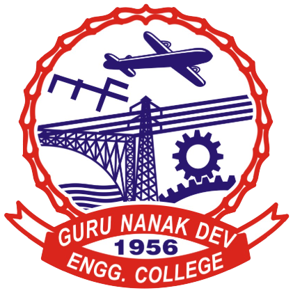

 

  

<h1 align="center">Guru Nanak Dev Engineering College, Ludhiana</h1>
<h1 align="center">Department of Civil Engineering</h1>

  <b>Expert Lecture</b> 
  <b>on</b> 
  <b>SUSTAINABLE CONSTRUCTION ACHIEVED BY ENHANCING CORROSION-FREE SERVICE LIFE</b>

  
  
  

---

**Speaker:** Dr. Shweta Goyal  
> Professor & Head  
> Department of Civil Engineering
> TIET, Patiala

---

  <b>Date:</b> Thursday, 05 November 2026 
  <b>Time:</b> 12:30 PM onwards 
  <b>Venue:</b> TCC Seminar Hall, GNDEC, Ludhiana

---

  <b>Organised by</b> 
  Department of Civil Engineering 
  Guru Nanak Dev Engineering College, Ludhiana

  <b>For details, contact:</b> 
  Dr. Yuvraj Singh 
  Department of Civil Engineering

