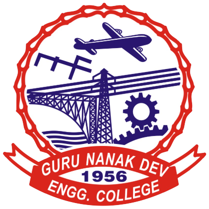

 

  

<h1 align="center">Guru Nanak Dev Engineering College, Ludhiana</h1>
<h1 align="center">Department of Civil Engineering</h1>

<h2 align="center">ACTIVITY REPORT</h2>

<h3 align="center">Expert Lecture on Sustainable Construction Achieved by Enhancing Corrosion-Free Service Life</h3>

  
  
  

---

## 1. Event Details

| Particulars | Details |
|:---|:---|
| **Event Title** | Expert Lecture on Sustainable Construction Achieved by Enhancing Corrosion-Free Service Life |
| **Date** | Friday, 06 November 2026 |
| **Time** | 11:30 AM onwards |
| **Venue** | TCC Seminar Hall, GNDEC, Ludhiana |
| **Speaker** | Dr. Shweta Goyal |
| **Designation** | Professor and Head, Department of Civil Engineering |
| **Institution** | Thapar Institute of Engineering & Technology, Patiala |
| **Organising Institution** | Department of Civil Engineering, Guru Nanak Dev Engineering College, Ludhiana |
| **Mentorship** | Dr. Harvinder Singh, Professor and Head, Department of Civil Engineering, GNDEC |
| **Event Coordinator** | Dr. Yuvraj Singh, Department of Civil Engineering |
| **Event Brochure** | [Enclosed](../Brochure/Expert_Talk_CED_05.11.2026.png) |

---

## 2. Speaker Profile

Dr. Shweta Goyal is a Professor and Head of the Department of Civil Engineering at Thapar Institute of Engineering & Technology, Patiala. With over two decades of academic and research experience, she has made significant contributions to structural engineering, corrosion evaluation and protection of reinforced concrete structures, self-healing and microbial concrete, accelerated carbonation curing, and sustainable construction materials. She is a gold medallist in both her Bachelor's and Master's degrees and has an extensive research portfolio comprising scholarly publications, sponsored projects and patents. Her research work has received considerable recognition, with over 2,200 citations on Google Scholar.

## 3. Report on the Activity

The Department of Civil Engineering, Guru Nanak Dev Engineering College (GNDEC), Ludhiana, organised an expert lecture on <b>“Sustainable Construction Achieved by Enhancing Corrosion-Free Service Life”</b> on 06 November 2026 at the TCC Seminar Hall. The session was delivered by Dr. Shweta Goyal, Professor and Head, Department of Civil Engineering, Thapar Institute of Engineering & Technology, Patiala.

The lecture highlighted the importance of enhancing the durability and service life of reinforced concrete structures as a key approach towards sustainable construction. The discussion covered reinforcement corrosion, its underlying mechanisms, corrosion evaluation and protection strategies, and emerging approaches such as self-healing and microbial concrete. The session also addressed the relevance of advanced concrete technologies and preventive maintenance in minimising structural deterioration, reducing repair requirements and promoting resource-efficient construction practices.

The programme was conducted under the mentorship of <b>Dr. Harvinder Singh, Professor and Head, Department of Civil Engineering, GNDEC</b>, reflecting the department's continued emphasis on expert interaction and the integration of academic learning with contemporary research and professional practices. Dr. Yuvraj Singh coordinated the event on behalf of the department.

The lecture was followed by an interactive question-and-answer session, providing participants an opportunity to engage with the speaker and seek clarification on relevant technical aspects. A short online quiz based on the lecture was also conducted to reinforce key concepts and assess participants' understanding of the subject.

---

## 4. Outcome of the Activity

The expert lecture enhanced participants' understanding of reinforcement corrosion, durability enhancement and emerging technologies for extending the service life of reinforced concrete structures. It highlighted the role of corrosion prevention, condition assessment, self-healing materials and sustainable construction practices in reducing deterioration and life-cycle resource consumption. The interaction with an experienced academician and researcher also encouraged students and faculty members to explore contemporary developments and research opportunities in durable and sustainable concrete construction.

---

## 5. Attendance & Feedback

  <b>Scan the QR code below to submit your attendance and feedback.</b>

 

  <i>Attendance and Feedback Form</i>

---

## 6. Photographs

  <b>Enclosure:</b> <a href="../Brochure/Expert_Talk_CED_05.11.2026.png">Event Brochure</a>

---

<table width="100%">
  <tr>
    <td width="50%" align="left" valign="top">
         
      ___________________________________ 
      <b>Dr. Yuvraj Singh</b> 
      Event Coordinator 
      Department of Civil Engineering 
      Guru Nanak Dev Engineering College 
      Ludhiana
    </td>
    <td width="50%" align="right" valign="top">
         
      ___________________________________ 
      <b>Dr. Harvinder Singh</b> 
      Professor and Head 
      Department of Civil Engineering 
      Guru Nanak Dev Engineering College 
      Ludhiana
    </td>
  </tr>
</table>
